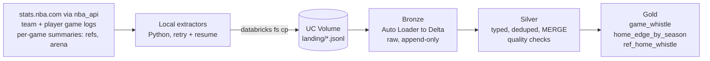

# NBA Lakehouse on Databricks

Medallion pipeline (Bronze / Silver / Gold) on Databricks Free Edition with Delta Lake, built on ten seasons of NBA data. The analysis question: **do individual referees give home teams a measurably different whistle, after adjusting for the teams playing?**

Orchestrated as a single Databricks Asset Bundle job. Every layer is idempotent and the Silver layer fails the job on bad data instead of loading it.

## Architecture



Extraction runs on a laptop, not in Databricks (see challenge 1). Everything from the Volume onward runs in one Databricks job: `bronze -> silver -> gold`.

## Data

| Source | Content | Volume |
|---|---|---|
| `LeagueGameLog` (team) | box score totals per team per game | 25,624 rows |
| `LeagueGameLog` (player) | box score per player per game | 272,901 rows |
| `BoxScoreSummaryV3` | referees, arena, attendance, neutral-site flag per game | 12,809 games (3 empty at the source) |

Seasons 2016-17 to 2025-26, regular season and playoffs. Raw data is not committed (NBA.com terms of use); the extractors recreate it.

## Layers

**Bronze** ([notebooks/01_bronze.py](notebooks/01_bronze.py)): Auto Loader with `availableNow`, all columns kept as strings plus `_source_file`, `_file_modified_at`, `_ingested_at`. The checkpoint makes a rerun with no new files a no-op; `allowOverwrites` lets a re-pulled season file flow through.

**Silver** ([notebooks/02_silver.py](notebooks/02_silver.py)): `team_games`, `game_info`, `game_officials`. Typed, deduplicated (latest file version wins), upserted with `MERGE`. Assert-based checks run before the merge: two rows per game, exactly one winner, plus-minus nets to zero, team points equal the sum of player points, every game has a summary unless the extractor listed it as empty at the source (and vice versa), home team agrees across both sources, one to four officials per game.

**Gold** ([notebooks/03_gold.py](notebooks/03_gold.py)): see the analysis below.

## Analysis: home whistle by ref

For each game, `fta_diff = home FTA - away FTA` and `foul_diff = away PF - home PF` (positive favors the home team). A ridge regression (closed form, numpy only) estimates each referee's effect with season intercepts and home and away team-season effects as controls. Crews rotate, so a ref's effect is separated from their partners' and from team style. The ref penalty is chosen by 5-fold cross-validation; 95% intervals come from 500 bootstrap resamples of games.

The model uses 11,876 regular-season games with exactly three officials. Neutral-site games and the 2020 Orlando bubble are excluded. Playoff games stay in the baseline table but not in the model: many list a fourth official and the feed does not say who calls fouls.

The job checks its own work on every run:
- **Estimator self-check:** it plants known ref effects in the real design matrix, refits, and fails unless it recovers them.
- **Permutation test:** it shuffles which crew worked which game within each season (destroying any real ref effect, keeping team and season structure) and counts how many refs get flagged. Results are stored in `nba_gold.ref_home_whistle_null`.

## Findings

- **Home teams get a small whistle edge.** Across 11,878 regular-season games, home teams shoot 0.55 more free throws and are called for 0.34 fewer fouls per game than their opponents.
- **Referees differ from each other.** Among the 72 refs with 200+ games, adjusted effects on the home free-throw margin have a standard deviation of 0.52 per game and range from -1.39 to +1.10. The spread between refs is about as large as the entire league-wide home edge.
- **That spread is more than noise.** 11 of 72 refs have a 95% interval excluding zero on free throws and 11 on fouls, against about 3.6 expected by chance. In the permutation test the real data flagged 13 (free throws) and 11 (fouls) refs, while 20 shuffles flagged 3.9 and 4.2 on average and never more than 9 and 7. Eight refs are flagged on both measures; the two effects correlate at 0.78 across all 113 refs, partly by construction since fouls produce free throws.
- **What this does not show.** These are statistical tendencies over hundreds of games, not evidence of intent or bias. Foul calls are made by any of the three crew members, so effects are attributed to refs only through crew rotation. Ref assignment is not random, and the model controls for the teams but not for everything else about a matchup. Twenty shuffles cannot resolve a p-value below about 0.05. In synthetic tests the bootstrap intervals flagged 4-7% of refs when no effect existed (nominal 5%).

Per-referee results are in `nba_gold.ref_home_whistle`.

## Engineering challenges solved

1. **stats.nba.com times out from Databricks.** The same `nba_api` call returns in 0.4 s from a laptop and times out at 60 s from serverless compute, while pypi.org, github.com and api.jolpi.ca answer fine from the same notebook. Fix: extraction moved to a local script that uploads to a Unity Catalog Volume; Databricks does Bronze onward.
2. **Plain `curl` is blocked, `nba_api` is not.** Even from a home network, `curl` with browser-like headers hangs while `nba_api` answers. The API filters on client fingerprint, so the extractors use `nba_api` and, for official.nba.com, a browser User-Agent and Referer.
3. **`CREATE CATALOG` fails on Free Edition** ("Metastore storage root URL does not exist"). Fix: use schemas `nba_bronze`, `nba_silver`, `nba_gold` in the default `workspace` catalog.
4. **`BoxScoreSummaryV2` returns `None` attendance for many games** (the 2016 opener and bubble games), and nba_api itself warns about V2 gaps after April 2025. Fix: use `BoxScoreSummaryV3`.
5. **Auto Loader stores nested JSON as strings** when type inference is off, so `arena.arenaName` failed with `INVALID_EXTRACT_BASE_FIELD_TYPE`. Fix: Silver parses with `get_json_object` and `from_json`.
6. **Games with no home team.** Ten games from 2024-25 onward list both teams with `@` (they look like neutral-site games). Silver counts them rather than failing, and Gold excludes them through the home/away join.
7. **The API returns an empty shell for some games, and nba_api's parser crashes on it.** Three 2025-26 games (all 2025-11-19) came back with `gameId` and `arena` null, which raised `AttributeError` inside `BoxScoreSummaryV3` and killed a three-hour pull at 11,840 of 12,812 games. Retrying cannot fix a deterministic failure. Fix: call the raw endpoint, skip empty games, and list them in a "missing" file that Bronze ingests, so Silver's coverage check passes only when every gap is documented.
8. **Fourth officials in playoff games.** 393 games list four officials (almost all playoffs) and one lists two, which broke a strict "three officials" check. Because the feed's `assignment` field is blank, the model uses only regular-season games with exactly three officials.
9. **Row order changed the model.** Cross-validation folds and bootstrap draws depended on the order `toPandas()` returned rows, so the chosen ridge penalty could flip between runs. Found by rebuilding Gold locally in pandas, which reproduced Spark exactly only at one penalty. Fix: sort games before modeling.

## Setup

```bash
brew tap databricks/tap && brew install databricks
databricks auth login --host https://YOUR-WORKSPACE.cloud.databricks.com

python3 -m venv .venv && .venv/bin/pip install -r requirements.txt
.venv/bin/python extract/pull_game_logs.py        # ~1 min
.venv/bin/python extract/pull_game_summaries.py   # ~3 h, resumable

databricks schemas create nba_bronze workspace
databricks schemas create nba_silver workspace
databricks schemas create nba_gold workspace
databricks volumes create workspace nba_bronze landing MANAGED
databricks fs cp -r data/landing dbfs:/Volumes/workspace/nba_bronze/landing --overwrite

databricks bundle deploy
databricks bundle run nba_pipeline
```

Free Edition only: serverless compute, no paid resources.
